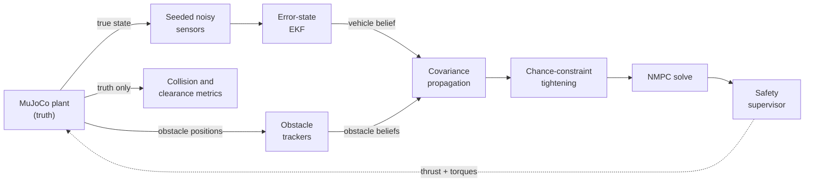

# Overview: how the system fits together

> **In short:** a quadrotor flies to a goal past moving obstacles. A nonlinear
> MPC plans 1 s ahead every 50 ms, but it only sees *noisy estimates*, so it
> inflates each obstacle by an amount that depends on how uncertain those
> estimates are. A supervisor checks every plan before it reaches the motors.
>
> **Read next:** [model conventions](conventions.md), then the numbered concept
> pages in order.

## Two model tracks

The repository contains two controllers that are intentionally **not** the
same model.

| | 9-state ODE track | 13-state native track |
|---|---|---|
| Purpose | teaching baseline, fast paired experiments and sweeps | the research pipeline that is validated |
| Controller | CVXPY QP / SciPy CC-MPC (`control/ccmpc/`) | do-mpc / CasADi / IPOPT NMPC (`control/nmpc/`) |
| State | position, velocity, Euler angles | position, velocity, quaternion, body rates |
| Plant | 9-state ODE (RK4) | MuJoCo Crazyflie 2 rigid body |
| Obstacles | ellipsoids | spheres |
| Entry points | `quadrotor-mpc-run`, `-sim`, `-sweep`, `-dashboard` | `quadrotor-mpc-app`, `-native`, `-monte-carlo` |
| Guide | [ODE experiments](../guides/ode-experiments.md) | [Native simulation](../guides/native-simulation.md) |

Keeping the models separate exposes model mismatch: a controller is never
validated only against the exact equations it predicts with. Everything below
describes the **native track** unless stated otherwise.

## The closed loop

The controller receives **beliefs** (mean + covariance), never MuJoCo truth.
Truth is used only to generate sensor readings and to score the run.

## One control tick

The controller runs every `mpc_timestep_s` (50 ms in the shipped scenarios);
MuJoCo integrates at `mujoco_timestep_s` (2 ms) in between.

1. **Solve** from the current beliefs: propagate covariance along the
   20-node horizon, tighten the obstacle constraints, solve the NMPC once,
   then re-check the solution and compute its risk certificate.
2. **Supervise**: accept the command or replace it with a fallback.
3. **Apply** the command to MuJoCo for one control interval.
4. **Predict** the estimators forward by the same interval.
5. **Measure** the new truth through the noisy sensors and update the filters.
6. **Record** telemetry and expose the new beliefs to the next tick.

Measuring after applying the command guarantees that no future measurement can
influence the command that produced it. Solver deadline misses are measured
against the control interval, not the physics step.

## Build-up stages

The native pipeline was built in eight stages. Code comments, tests and older
notes still use these numbers, so this table maps them to pages:

| Stage | Feature | Page |
|---:|---|---|
| 1 | Belief-based controller interface (`reset` / `solve`) | [Controller interface](../reference/controller-interface.md) |
| 2 | Seeded sensors, vehicle ESEKF, obstacle trackers | [Sensing and estimation](estimation.md) |
| 3 | Covariance propagation over the horizon | [Covariance propagation](covariance-propagation.md) |
| 4 | Spherical chance constraints | [Chance constraints](chance-constraints.md) |
| 5 | Individual vs joint risk budget | [Risk budget](risk-budget.md) |
| 6 | Acceptance gates and fallback hierarchy | [Safety supervisor and fallback](safety-fallback.md) |
| 7 | Qt safety console | [Desktop safety panel](../reference/desktop-safety-panel.md) |
| 8 | Paired native Monte Carlo validation | [Monte Carlo campaigns](../guides/monte-carlo.md) |

Each stage can be switched off in YAML, and switching off chance constraints
and the supervisor reproduces the deterministic baseline exactly.

## Glossary

| Term | Meaning |
|---|---|
| Belief | Mean and covariance of a state estimate (`VehicleBelief`, `ObstacleBelief`). |
| Horizon, node | The NMPC plans `N = 20` steps ahead; node `k` is the predicted state after `k` steps. Node 0 is the measured current state and is never constrained. |
| TVP | Time-varying parameter of the compiled do-mpc problem. Obstacle means and tightened radii are TVPs, so they can change every tick without recompiling. |
| Chance constraint | "Collision with obstacle *o* at node *k* has probability at most εk,o", turned into a deterministic distance constraint. |
| Tightened radius | Base safety radius plus `Φ⁻¹(1-ε) · σ`, where σ is the uncertainty projected on the obstacle direction. |
| Slack | Amount by which the solver relaxed a distance constraint. Positive slack means that cell missed its allocated risk. |
| Risk budget | How ε is assigned: *individual* (same ε for every cell) or *joint* (one total ε split across all `N × n_obs` cells). |
| Risk certificate | Post-solve check of the linearized collision risk of the whole horizon against the budget: `CERTIFIED` or `EXCEEDED`. |
| Supervisor, fallback | The layer that accepts a command or replaces it with hold-last, position-hold or emergency hover. |
| `HORIZON_GUARANTEE_ELIGIBLE` | Every technical gate passed for this one prediction horizon. Not an episode-wide guarantee. |
| Covariance level | Monte Carlo noise setting; `4 Σ` multiplies covariances by 4 and standard deviations by 2. |
| Paired seeds | Every controller is run with the same seeds, so differences come from the controller and not from luck. |
| `EMPIRICALLY_SUPPORTED_NOT_PROVEN` | Best Monte Carlo claim status: no finite-sample blocker applied. Still not a proof. |
| `VALIDATED_WITH_LIMITATIONS` | Validation status of a complete campaign in which a claim, collision-bound or timing gate failed. See [claims and statistics](../validation/claims-and-statistics.md). |
