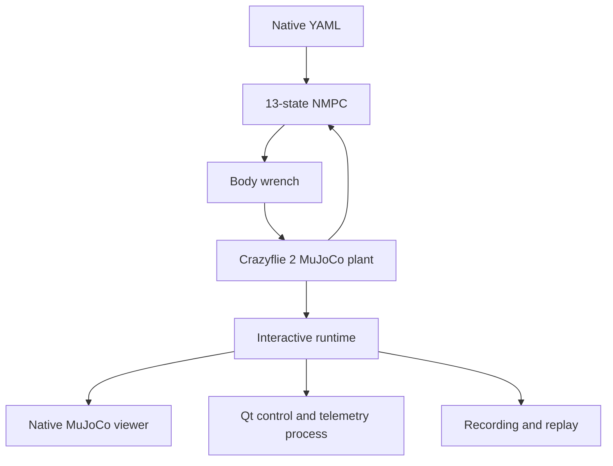

# Native simulation

> **In short:** run one 13-state NMPC episode on the MuJoCo Crazyflie, either
> headless, in the desktop workbench, or in the MuJoCo 3-D window with the Qt
> safety panel; record it and replay it later without solving.
>
> **Before this:** [first run](../getting-started/first-run.md) · **Related:**
> [scenarios](scenarios.md), [desktop safety panel](../reference/desktop-safety-panel.md)
> · **Code:** `quadrotor_mpc/interfaces/desktop/viewer.py`,
> `quadrotor_mpc/application/native/runtime.py`

The viewer is only an observer: `application/native/runtime.py` is the sole
owner of controller execution and physics stepping.

## Three ways to run

| Mode | Command | When |
|---|---|---|
| Workbench | `quadrotor-mpc-app` → **Simulate** | quick runs and comparisons, any OS |
| Headless | `quadrotor-mpc-native --config <yaml> --headless` | scripts, servers, reproducible recordings |
| 3-D viewer + safety panel | `MUJOCO_GL=glfw quadrotor-mpc-native --config <yaml>` | inspect behaviour tick by tick (Linux desktop) |

Headless runs accept `--mode {deterministic,individual,joint_uniform}`,
`--noise-scale`, `--seed` and `--duration`, applied exactly like a Monte Carlo
trial, and exit when the episode ends. `--progress-json` prints one
`@@progress {...}` line per tick and a final `@@result {...}` line.

## Running the viewer

Installation and OpenGL requirements are in
[installation](../getting-started/installation.md). Then:

```bash
MUJOCO_GL=glfw quadrotor-mpc-native        # default: config/mujoco_native.yaml
```

Run the dynamic crossing scenario:

```bash
MUJOCO_GL=glfw quadrotor-mpc-native \
  --config config/mujoco_native_dynamic.yaml
```

Validate the YAML without opening a window:

```bash
quadrotor-mpc-native --validate-config
```

Useful overrides:

```bash
quadrotor-mpc-native --camera fixed
quadrotor-mpc-native --realtime-factor 0
quadrotor-mpc-native --no-trail --no-prediction
quadrotor-mpc-native --show-contacts
quadrotor-mpc-native --no-panel
quadrotor-mpc-native --no-record
```

Closing the native window cleanly terminates the control loop. In interactive
mode, reaching the goal, a configured collision stop, or the scenario duration
puts the simulation into a held `COMPLETED` state instead of closing either
window. The process exits only after Stop/Esc or window close. Headless runs
still terminate automatically for batch and Monte Carlo workflows.

## Interactive controls

The MuJoCo window and Qt panel send commands through the same queue. Commands
are processed only by `quadrotor_mpc/application/native/runtime.py`; neither UI is allowed to advance physics.

| Keyboard | Panel | Action |
|---|---|---|
| `Space` | Pause / Resume | Toggle the controller/plant loop |
| `N` | Step | Execute exactly one MPC tick while paused |
| `R` | Reset | Reset plant, controller history, clock and current telemetry |
| `Enter` | Run again | Reset the complete episode and immediately resume |
| `Esc` | Stop | End the run cleanly |
| `S` | Snapshot | Write the latest telemetry sample into the run bundle |
| `T` | Trail | Toggle the executed path |
| `P` | MPC prediction | Toggle the predicted vehicle horizon |
| `C` | Safety shells | Toggle obstacle safety envelopes |
| `F` | Follow camera | Toggle follow/fixed camera |

The panel is a safety console rather than a single dense status line. It shows
separate cards for episode state, applied controller, guarantee eligibility,
joint-risk budget, slack state and solver deadline. Bounded plots include
position, clearance/chance residual/slack, propagated uncertainty/tightened
radius, control, solve time/deadline, and risk/acceptance/fallback state.

Positive slack and fallback are always displayed as `NOT GUARANTEED`.
Transition alerts are deduplicated and bounded by `panel.maximum_alerts`.
The panel updates at a lower rate than MuJoCo, so it does not retain an
unbounded session or redraw at the 500 Hz physics rate. See
[desktop safety panel](../reference/desktop-safety-panel.md).
After `COMPLETED`, press **Run again** to repeat the same scenario without
restarting Python. **Reset** preserves the current pause/run mode, while
**Run again** always resumes.

## Configuration

The default file is `config/mujoco_native.yaml`. It defines:

- initial position and attitude;
- goal position and attitude;
- actuator bounds and safety margin;
- MPC and MuJoCo timesteps;
- horizon, solver iterations and stop conditions;
- camera, real-time pacing and overlays;
- static spheres and dynamic obstacle motion;
- control-panel update/history options;
- recording directory and buffer limit.

The orange transparent shell is the controller safety envelope
`obstacle radius + margin + vehicle collision radius`. The solid obstacle is the
actual contact geometry. Blue is the executed trail and green is the most recent
NMPC predicted position horizon.

Static and moving obstacles (constant velocity, sinusoid, waypoints) are
described in [scenarios](scenarios.md#native-obstacles).

## Recording and replay

An enabled run writes a self-contained directory under `outputs/native/`:

```text
<timestamp>_<scenario>/
├── scenario.yaml
├── summary.yaml
├── telemetry.csv
├── trajectory.npz
├── events.jsonl
└── snapshot-*.json
```

`telemetry.csv` is the portable analysis table. `trajectory.npz` preserves the
13-state trajectory, vehicle prediction and obstacle prediction as numeric arrays
with pickle disabled during replay. `events.jsonl` records pause, step, reset,
overlay and stop commands.

Replay does not call do-mpc/IPOPT:

```bash
MUJOCO_GL=glfw quadrotor-mpc-native \
  --replay outputs/native/<timestamp>_<scenario>
```

It reconstructs the effective scenario, drives the same Crazyflie MuJoCo model
through recorded states and feeds the recorded telemetry back into the panel.

## Runtime architecture




## Model provenance

The production plant uses the
[Bitcraze Crazyflie 2 model from Google DeepMind MuJoCo Menagerie](https://github.com/google-deepmind/mujoco_menagerie/tree/main/bitcraze_crazyflie_2),
vendored at commit `71f066ad0be9cd271f7ed58c030243ef157af9f4` under
`models/bitcraze_crazyflie_2/`. The upstream MIT license is preserved.

The upstream model supplies:

| Quantity | Value |
|---|---:|
| Mass | `0.027 kg` |
| $I_{xx}$ | `2.3951e-5 kg m^2` |
| $I_{yy}$ | `2.3951e-5 kg m^2` |
| $I_{zz}$ | `3.2347e-5 kg m^2` |
| Hover thrust | `0.26487 N` |
| Upstream maximum combined thrust | `0.35 N` |

The workbench loads the upstream MJCF and meshes unchanged through MuJoCo's
virtual file system, then adds a separate ground, goal and obstacle scene. The
old box-and-sphere `models/quadrotor.xml` was removed because it duplicated the
reference model without trustworthy vehicle provenance.

Upstream explicitly says that its body-moment `ctrlrange` values are arbitrary.
Therefore `quadrotor_mpc/core/vehicle.py` distinguishes sourced mass/inertia from conservative
workbench torque assumptions. Results must not present the latter as measured
Crazyflie actuator limits.

## Current fidelity boundary

The model is a sourced rigid body with detailed visual/collision meshes, but the
control interface remains a combined body wrench. It does not yet model:

- four motor electrical dynamics;
- individual rotor RPM, thrust coefficient and drag coefficient;
- propeller gyroscopic moments, induced flow or ground effect;
- battery voltage sag;
- sensor latency and bias in the optional 13-state track.

The native CC-MPC pipeline now exposes 12D vehicle and 6D obstacle covariance
horizons. The viewer visualizes their effect through tightened spherical
safety shells and assurance-aware path/vehicle colors; exact uncertainty values
remain in the telemetry panel and recording. FOV geometry is not implemented
and must not be fabricated as a viewer-only graphic.
