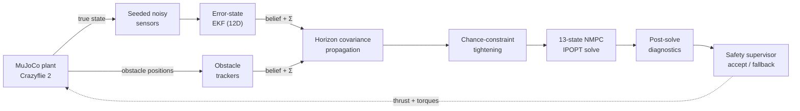

<div align="center">

# Quadrotor MPC Research Workbench

**Chance-constrained model predictive control for quadrotor obstacle avoidance:
from a 9-state teaching baseline to a 13-state NMPC flying a MuJoCo Crazyflie 2
on estimated, uncertain state.**

[](https://www.python.org/)
[](https://github.com/Hunggh06/quadrotor_ccmpc/actions/workflows/ci.yml)
[](LICENSE)
[](#validation-status)


<sub>Existing baseline demonstration, seed 1001, nominal noise. Blue: flown path ·
green: NMPC prediction horizon · orange: predicted obstacle motion · yellow: goal.</sub>

<br><br>

[Quick start](#quick-start) · [How it works](#how-it-works) · [Joint-risk experiments](#joint-risk-experiments) · [Code guide](2.Code/README.md)

</div>

> [!NOTE]
> **Status:** research prototype, not a production flight controller. Horizon-wise
> chance constraints do not establish an episode-wide probabilistic safety
> guarantee, and meeting the 50 ms (20 Hz) real-time period is not established.

## Contents

- [Highlights](#highlights)
- [How it works](#how-it-works)
- [Desktop workbench](#desktop-workbench)
- [Installation](#installation)
- [Quick start](#quick-start)
- [Joint-risk experiments](#joint-risk-experiments)
- [Validation status](#validation-status)
- [Repository map](#repository-map)
- [Scope boundaries](#scope-boundaries)
- [Documentation](#documentation)

## Highlights

<table>
<tr>
<td width="50%" valign="top">

**Two model tracks**

- 9-state MPC / CC-MPC reference controller using CVXPY.
- 13-state quaternion NMPC (do-mpc / CasADi) on the sourced Bitcraze
  Crazyflie 2 MuJoCo model. The models stay separate on purpose to expose
  model mismatch.

</td>
<td width="50%" valign="top">

**Uncertainty all the way through**

- Seeded sensors, a 12D error-state EKF and probabilistic obstacle trackers.
  Estimated-state runs feed beliefs, not hidden MuJoCo truth, to the controller.
- Horizon covariance propagation, spherical chance constraints, individual or
  joint-uniform risk allocation and post-solve diagnostics.

</td>
</tr>
<tr>
<td valign="top">

**Safety layer**

- Explicit soft-slack reporting, solution acceptance gates and a bounded
  fallback controller, including deadline handling.
- Telemetry records solver status, clearance and fallback activity so failures
  are visible rather than hidden behind a trajectory plot.

</td>
<td valign="top">

**Joint-risk research**

- Opt-in joint-risk NLP with optimized risk allocation, kept separate from
  the original uniform-allocation baseline.
- Paired-seed experiments, resumable benchmarks and analysis with Wilson
  intervals, McNemar tests and Holm correction.

</td>
</tr>
</table>

## How it works



Each obstacle constraint is evaluated on the controllable nodes
x<sub>1</sub>…x<sub>N</sub>. The covariance of the vehicle and of each
obstacle is propagated along the horizon and projected on the separating
direction, which turns a collision probability ε into a larger keep-out
radius. The baseline joint mode splits one **horizon budget** over all
N × n<sub>obs</sub> cells, so it tightens more than the individual mode:

<p align="center">

</p>

The original same-scenario comparison illustrates how those margins change
the flown path and clearance:

<p align="center">

</p>

<sub>Existing baseline figures, seed 1001, nominal noise,
<code>config/mujoco_native_ccmpc.yaml</code>. These illustrate the original
baseline, not a fresh benchmark of the current joint-risk NLP. A single seed
does not establish a statistical safety claim.</sub>

## Desktop workbench

The current code runs a **native MuJoCo 3-D viewer with a separate Qt
control/plot panel**. Use the same configuration for interactive runs,
headless recording and replay:

```bash
uv run quadrotor-mpc-native --config config/mujoco_native_ccmpc.yaml
```

Add `--no-panel` for the MuJoCo window alone, or `--headless` to record a run
without opening either window.

<details>
<summary>Earlier integrated workbench — interface gallery</summary>

<p align="center">

</p>

<table>
<tr>
<td width="50%"></td>
<td width="50%"></td>
</tr>
<tr>
<td valign="top"><b>Monte Carlo:</b> campaign configuration and progress.</td>
<td valign="top"><b>Results:</b> recorded runs and controller comparisons.</td>
</tr>
</table>

These screenshots are retained from the previous version. The integrated
`quadrotor-mpc-app`, Streamlit dashboard and root `.bat` launcher are not
part of the current simulation subset. Use `quadrotor-mpc-native` instead.

</details>

## Installation

Python **3.10+** is required; Python 3.12 was used for the current local checks.
Install [uv](https://docs.astral.sh/uv/), then:

```bash
git clone https://github.com/Hunggh06/quadrotor_ccmpc.git
cd quadrotor_ccmpc/2.Code
uv sync --extra full --extra dev --locked
```

<details>
<summary>Standard pip installation</summary>

From `quadrotor_ccmpc/2.Code/`:

```bash
python -m venv .venv
# Linux/macOS: source .venv/bin/activate
# Windows PowerShell: .\.venv\Scripts\Activate.ps1
python -m pip install --upgrade pip
python -m pip install -e ".[full,dev]"
```

</details>

MuJoCo and the Qt windows need a working desktop OpenGL runtime. Headless
simulation does not require a visible window; rendering video still needs a
working graphics backend.

## Quick start

Run the following commands from **`2.Code/`**.

**1. Check the configuration** — without launching the solver or viewer:

```bash
uv run quadrotor-mpc-native --config config/mujoco_native_ccmpc.yaml --validate-config
```

**2. Fly one episode** — native 3-D viewer and Qt panel:

```bash
uv run quadrotor-mpc-native --config config/mujoco_native_ccmpc.yaml
```

**3. Record a reproducible headless run:**

```bash
uv run quadrotor-mpc-native --config config/mujoco_native_ccmpc.yaml --headless --mode joint_uniform --seed 1001 --duration 10
```

| Mode | Controller |
|---|---|
| `deterministic` | NMPC without chance-constraint tightening |
| `individual` | CC-MPC with individual constraint risk |
| `joint_uniform` | CC-MPC with a uniformly split joint horizon budget |

Outputs are written to `outputs/native/<run>/` and stay out of Git. Add
`--progress-json` for machine-readable headless progress.

<details>
<summary>Replay, video export and trajectory reports</summary>

Replace `<run>` with an actual recording directory:

```bash
uv run quadrotor-mpc-native --replay outputs/native/<run>
uv run python scripts/export_native_video.py outputs/native/<run> --camera orbit
uv run python scripts/report_native_run.py outputs/native/<run>
```

The export scripts reuse recorded states instead of solving NMPC again.
Reports include `report.png`, `report_3d.html` and `report_timeseries.html`.
Omitting the run directory from either export script selects the latest
native recording.

</details>

## Joint-risk experiments

The experimental joint-risk NLP **optimizes risk allocation**, rather than
splitting the budget uniformly. It is explicitly opt-in: selecting
`--mode joint_uniform` in the native CLI does not enable it.

Compare the original baseline, hard uniform constraints and hard joint-risk
NLP on the same scene and seed:

```bash
uv run python experiments/joint_risk/run_joint_risk.py --scenario five_lowu_narrow --variant uniform --variant hard_uniform --variant joint_hard --seed 1001 --duration 6 --tag demo
```

| Variant | Risk allocation | Chance constraints |
|---|---|---|
| `uniform` | Uniform baseline | As configured in the scenario |
| `hard_uniform` | Uniform baseline | Hard |
| `joint_soft` | Optimized, `required` formulation | Soft relaxation |
| `joint_hard` | Optimized, `required` formulation | Hard |

Available scenes: `five_lowu_narrow`, `five_lowu`, `five_through`, `cc_ablation`.
Recordings and experiment metadata are written to `outputs/joint_risk/`.

<details>
<summary>Resumable paired-seed benchmark</summary>

Inspect the frozen 90-case schedule before starting a longer benchmark:

```bash
uv run python experiments/joint_risk/run_joint_multiseed.py --dry-run
```

Remove `--dry-run` to execute. The runner checks source/configuration
fingerprints before resuming, and the analysis treats a seed-level run—not
each control tick—as the sampling unit. See the
[code guide](2.Code/README.md#joint-risk-thử-nghiệm) for details.

</details>

## Validation status

| Current local check | Result |
|---|---|
| Joint-risk, interpolation and paired-seed analysis tests | **21/21 passed** |
| Python syntax | All 70 source files parsed |
| Four native configuration files | Validated |
| Dependency lockfile | Checked |
| Source distribution and wheel | Built successfully |

Reproduce the test/build checks from `2.Code/`:

```bash
uv run python -m unittest discover -s tests -v
uv run python -m build
```

> [!IMPORTANT]
> These are software checks, not a new collision-probability validation
> campaign. The existing GIFs, plots and historical campaign results predate
> this code snapshot and must not be quoted as current joint-risk NLP results.

The previous Stage 8 campaign and its limitations remain available in the
[repository history](https://github.com/Hunggh06/quadrotor_ccmpc/tree/29dca66ebe097fe70bfb67d87ba74a87ab46c0a2/2.Code/validation/stage8_30_seed).
Zero observed collisions must not be presented as a formal probabilistic
guarantee; soft slack, fallback activity and solver timing need to be read
alongside any success rate.

## Repository map

```text
quadrotor_ccmpc/
├── 1.Docs/
│   ├── Theory/              background theory and formula references
│   └── Paper/               source papers
├── 2.Code/                  current ccmpc_project code
│   ├── simulation/          control, estimation, plant, runtime and CLI/Qt
│   ├── visualization/       plots and recording-based reports
│   ├── config/              native, scenario and experiment YAML files
│   ├── models/              sourced Crazyflie 2 model and license
│   ├── experiments/         joint-risk, ablation and paired-seed analysis
│   ├── scripts/             video, reports and illustration exports
│   ├── tests/               current regression tests
│   ├── pyproject.toml
│   ├── uv.lock
│   └── README.md            detailed code guide
├── 3.Notebooks/             earlier learning notebooks
├── assets/readme/           existing demo figures and interface gallery
├── LICENSE
└── README.md
```

The current packages are `simulation` and `visualization`, replacing the old
`quadrotor_mpc` package. Documentation and notebooks outside `2.Code/` are
retained as background material; their older imports may need migration.
Virtual environments, caches, generated results, papers and slides from the
local working project are not included in the code sync.

## Scope boundaries

This repository does not currently implement:

- a depth-camera or vision detection pipeline;
- ROS 2 integration;
- hardware-in-the-loop or real flight deployment;
- a solver proven to meet the `50 ms` controller period;
- a formal episode-wide collision-probability proof.

Those are separate future research/deployment tracks, not hidden capabilities
of the current code.

## Documentation

| If you want to | Start here |
|---|---|
| Install and fly a first episode | [Installation](#installation) · [Quick start](#quick-start) |
| Work with the current code | [Code guide](2.Code/README.md) |
| Understand the controller | [13-state NMPC](2.Code/simulation/control/ccmpc_13state/) · [9-state reference](2.Code/simulation/control/ccmpc_9state/) |
| Run joint-risk experiments | [Experiment scripts](2.Code/experiments/joint_risk/) · [Scenario configurations](2.Code/config/experiments/) |
| Inspect estimation and uncertainty | [Estimators](2.Code/simulation/estimation/) · [Covariance propagation](2.Code/simulation/control/ccmpc_13state/covariance.py) |
| Read the theory | [Theory chapters](1.Docs/Theory/) (Vietnamese) |
| Explore the earlier learning track | [Notebooks](3.Notebooks/README.md) (older package imports) |

## References

- H. Zhu and J. Alonso-Mora, “Chance-Constrained Collision Avoidance
  for MAVs in Dynamic Environments,” IEEE RA-L, 2019.
- J. Lin, H. Zhu and J. Alonso-Mora, “Robust Vision-based Obstacle
  Avoidance for MAVs in Dynamic Environments,” IEEE ICRA, 2020.

The papers motivate the formulation; their published performance figures are
not presented as measurements of this implementation.

## License

The workbench retains the [MIT License](LICENSE) and original attribution.
The vendored Crazyflie model retains its own
[upstream MIT license](2.Code/models/bitcraze_crazyflie_2/LICENSE).
