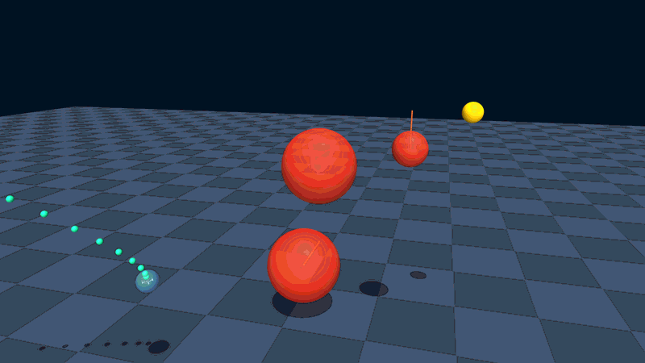
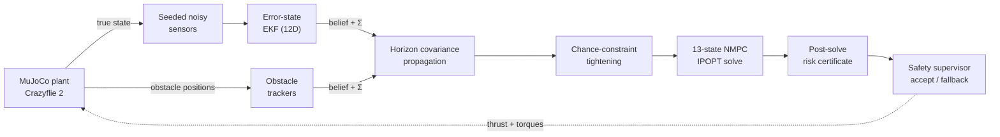
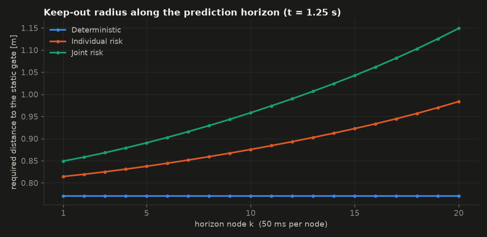
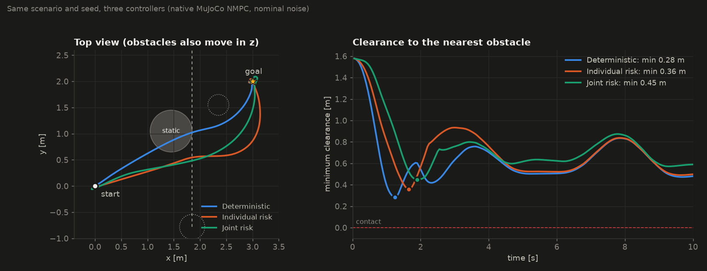
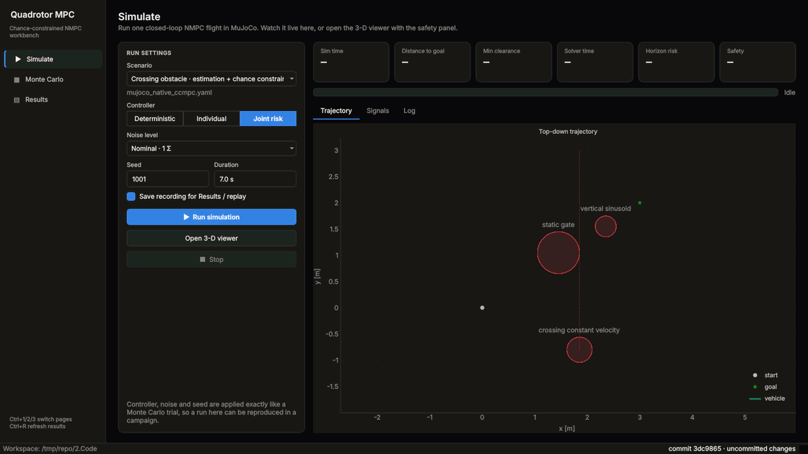
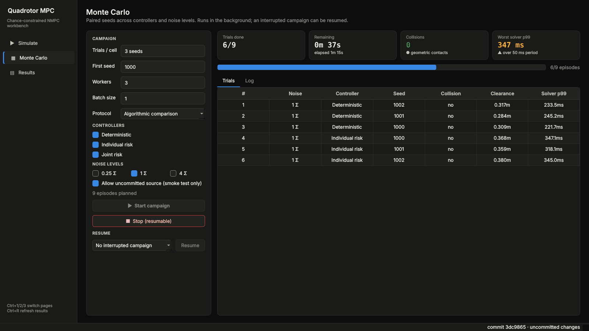
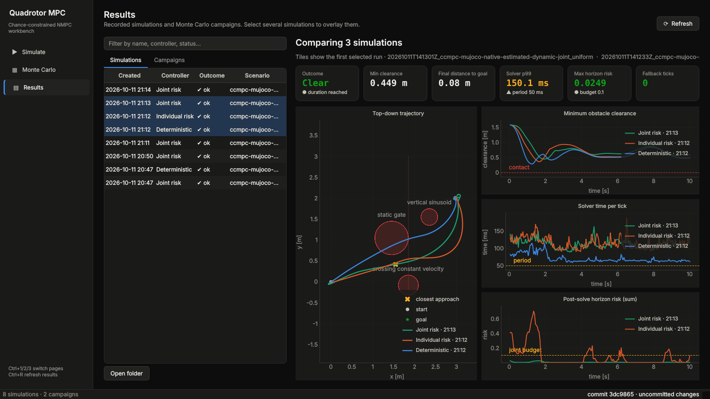

<div align="center">

# Quadrotor MPC Research Workbench

**Chance-constrained model predictive control for quadrotor obstacle avoidance:
from a 9-state teaching baseline to a 13-state NMPC flying a MuJoCo Crazyflie 2
on estimated, uncertain state.**

[](https://www.python.org/)
[](LICENSE)
[](2.Code/docs/validation/claims-and-statistics.md)



<sub>Joint-risk CC-MPC, seed 1001, nominal noise. Blue: flown path · green: NMPC
prediction horizon · orange: predicted obstacle motion · yellow: goal.</sub>

</div>

> [!NOTE]
> **Status:** feature-complete research prototype, empirically validated with
> documented limitations. It is not a production flight controller, it does
> not establish an episode-wide probabilistic safety guarantee, and the chance
> controllers do not yet meet the 50 ms (20 Hz) real-time period.

## Contents

- [Highlights](#highlights)
- [How it works](#how-it-works)
- [Desktop workbench](#desktop-workbench)
- [Installation](#installation)
- [Quick start](#quick-start)
- [Validation status](#validation-status)
- [Repository map](#repository-map)
- [Scope boundaries](#scope-boundaries)
- [Documentation](#documentation)

## Highlights

<table>
<tr>
<td width="50%" valign="top">

**Two model tracks**

- 9-state MPC / CC-MPC baseline (CVXPY QP) with paired experiments, sweeps
  and a Streamlit dashboard.
- 13-state quaternion NMPC (do-mpc / CasADi) on the sourced Bitcraze
  Crazyflie 2 MuJoCo model. The models stay separate on purpose to expose
  model mismatch.

</td>
<td width="50%" valign="top">

**Uncertainty all the way through**

- Seeded sensors, a 12D error-state EKF and probabilistic obstacle trackers.
  The controller never sees hidden MuJoCo truth.
- Horizon covariance propagation, spherical chance constraints, individual or
  joint-uniform risk allocation and a post-solve risk certificate.

</td>
</tr>
<tr>
<td valign="top">

**Safety layer**

- Explicit soft-slack reporting, solution acceptance gates and a bounded
  fallback controller, including enforced deadline fallback.

</td>
<td valign="top">

**Evidence, not anecdotes**

- Paired Monte Carlo validation with exact one-sided Clopper–Pearson collision
  bounds, Wilson intervals, McNemar tests with Holm correction and per-trial
  timing gates.

</td>
</tr>
</table>

## How it works



Each obstacle constraint is evaluated on the controllable nodes
x<sub>1</sub>…x<sub>N</sub>. The covariance of the vehicle and of each
obstacle is propagated along the horizon and projected on the separating
direction, which turns a collision probability ε into a larger keep-out
radius. The joint mode splits one episode budget over all N × n<sub>obs</sub>
cells, so it tightens more than the individual mode:

<p align="center">

</p>

On the same scenario and seed, that extra margin is visible in flight: the
minimum clearance grows from deterministic to individual to joint risk, while
all three still reach the goal.

<p align="center">

</p>

<sub>One episode per controller (seed 1001, nominal noise, `config/mujoco_native_ccmpc.yaml`).
A single seed illustrates the behaviour; statistical claims come from the Monte
Carlo campaigns below.</sub>

## Desktop workbench

`quadrotor-mpc-app` is one dark Qt window for the daily workflow, so no
terminal commands are needed. Jobs run out of process, so a slow solve never
freezes the window.

<p align="center">

</p>

<sub><b>Simulate</b> (Ctrl+1): pick scenario, controller, noise and seed, then watch the run live.</sub>

<table>
<tr>
<td width="50%"></td>
<td width="50%"></td>
</tr>
<tr>
<td valign="top"><b>Monte Carlo</b> (Ctrl+2): edit the protocol, then start, stop or resume a campaign while trials stream in.</td>
<td valign="top"><b>Results</b> (Ctrl+3): browse runs and campaigns, overlay up to three runs and read the validation gates.</td>
</tr>
</table>

On Windows, double-click **`Quadrotor MPC Workbench.bat`** at the repository
root. Elsewhere, run `cd 2.Code && uv run quadrotor-mpc-app`. See the
[workbench guide](2.Code/docs/getting-started/workbench.md).

## Installation

Python 3.10 or newer is required. Python 3.12 is used by the current validation
artifact.

```bash
git clone https://github.com/whoisLePhuc/quadrotor_mpc.git
cd quadrotor_mpc/2.Code
uv sync --all-extras --locked
```

<details>
<summary>Standard pip installation</summary>

```bash
cd quadrotor_mpc/2.Code
python -m venv .venv
# Linux/macOS: source .venv/bin/activate
# Windows PowerShell: .\.venv\Scripts\Activate.ps1
python -m pip install --upgrade pip
python -m pip install -e ".[full,dev]"
```

</details>

MuJoCo and the Qt windows need a working desktop OpenGL/EGL runtime. The ODE
baseline and headless Monte Carlo do not need a visible window.

## Quick start

1. Install as above.
2. Launch the workbench: `Quadrotor MPC Workbench.bat` (Windows) or
   `uv run quadrotor-mpc-app`.
3. On **Simulate**, choose *Joint risk* and press **Run simulation** (Ctrl+R).

<details>
<summary>Command-line equivalents</summary>

Run a tracked paired ODE experiment:

```bash
cd 2.Code
uv run quadrotor-mpc-run \
  --config config/scenarios/static_obstacle.yaml \
  --compare
```

Run the compact ODE simulation:

```bash
uv run quadrotor-mpc-sim \
  --config config/scenarios/moving_obstacle.yaml \
  --compare
```

Launch the ODE Streamlit dashboard:

```bash
uv run quadrotor-mpc-dashboard
```

Run one native episode without a window (add `--progress-json` for
machine-readable progress):

```bash
uv run quadrotor-mpc-native --config config/mujoco_native_ccmpc.yaml \
  --headless --mode joint_uniform --noise-scale 1.0 --seed 1001
```

Open the native 3-D viewer with the safety panel on a Linux desktop:

```bash
MUJOCO_GL=glfw uv run quadrotor-mpc-native \
  --config config/mujoco_native_ccmpc.yaml
```

Run the default 50-seed/cell native validation from a clean commit:

```bash
uv run quadrotor-mpc-monte-carlo \
  --config config/native_monte_carlo.yaml \
  --workers 3 \
  --batch-size 5
```

The Monte Carlo command accepts release evidence only from a clean Git tree or
a fingerprinted, non-editable installed distribution. `--allow-dirty-source`
exists only for explicitly non-release smoke campaigns and records the exact
source snapshot as non-release-eligible.

</details>

## Validation status

> [!IMPORTANT]
> The committed Stage 8 campaign predates the October 2026 corrections
> (constraints on the controllable nodes 1..N, post-solve re-projection,
> enforced deadline fallback, one-sided Clopper–Pearson gate, worst-trial
> timing gate, risk certificate). A new 50-seed campaign is required before
> quoting results for the current code.

Stage 8 (historical) contains 270 episodes, 30 paired seeds per
controller/noise cell:

| Check | Result |
|---|---|
| Geometric collisions, NaNs, risk-budget accounting failures | ✅ `0/270` |
| Positive slack in chance-controller cells | ⚠️ present in every cell |
| Joint-risk fallback across the uncertainty sweep | ⚠️ `46.7%` → `100%` |
| Joint risk reaching the goal at 4Σ | ❌ `0/30` |
| Solver p99 within the 50 ms period | ❌ not met |
| Collision upper bound vs the 0.10 gate (two-sided Wilson 95%, 30 trials) | ⚠️ `0.1135`, above the gate |

The result is therefore `VALIDATED_WITH_LIMITATIONS`. Zero observed collisions
must not be presented as a formal probabilistic guarantee. See the
[claim rules](2.Code/docs/validation/claims-and-statistics.md) and
[raw evidence](2.Code/validation/stage8_30_seed/).

<details>
<summary>Stage 8 report figure</summary>


</details>

## Repository map

```text
quadrotor_mpc/
├── 1.Docs/
│   ├── Theory/          theory chapters and formula reference
│   └── Paper/           source papers
├── 2.Code/
│   ├── quadrotor_mpc/   layered installable Python package
│   ├── config/          native and ODE configurations
│   ├── models/          sourced MuJoCo model and license
│   ├── tests/           unit, integration and release tests
│   ├── validation/      committed validation evidence
│   └── docs/            documentation (start at docs/README.md)
├── 3.Notebooks/         runnable learning notebooks (use the package)
├── assets/readme/       figures used by this README
├── Quadrotor MPC Workbench.bat
├── LICENSE
└── README.md
```

## Scope boundaries

This repository does not currently implement:

- a depth-camera or vision detection pipeline;
- ROS 2 integration;
- hardware-in-the-loop or real flight deployment;
- a solver proven to meet the `50 ms` controller period;
- a formal episode-wide collision-probability proof.

Those are separate future research/deployment tracks, not hidden capabilities
of the current release.

## Documentation

Start at the **[documentation index](2.Code/docs/README.md)**: it has reading
paths for newcomers, controller internals, experiments and code changes.

| If you want to | Read |
|---|---|
| Install and fly a first episode | [Installation](2.Code/docs/getting-started/installation.md) · [First run](2.Code/docs/getting-started/first-run.md) |
| Understand the pipeline and its vocabulary | [Overview](2.Code/docs/concepts/overview.md), then the numbered concept pages |
| Run experiments | [Native simulation](2.Code/docs/guides/native-simulation.md) · [Monte Carlo campaigns](2.Code/docs/guides/monte-carlo.md) · [ODE experiments](2.Code/docs/guides/ode-experiments.md) |
| Know what a result may claim | [Claims and statistics](2.Code/docs/validation/claims-and-statistics.md) |
| Change the code | [Architecture](2.Code/docs/reference/architecture.md) · [Controller interface](2.Code/docs/reference/controller-interface.md) |
| Learn by running code | [Notebooks](3.Notebooks/README.md): nine notebooks from the 9-state model to Monte Carlo statistics |
| Read the theory | [Theory chapters](1.Docs/Theory/README.md) |

## References

- H. Zhu and J. Alonso-Mora, “Chance-Constrained Collision Avoidance
  for MAVs in Dynamic Environments,” IEEE RA-L, 2019.
- J. Lin, H. Zhu and J. Alonso-Mora, “Robust Vision-based Obstacle
  Avoidance for MAVs in Dynamic Environments,” IEEE ICRA, 2020.

The papers motivate the formulation; their published performance figures are
not presented as measurements of this implementation.

## License

The workbench is released under the [MIT License](LICENSE). The vendored
Crazyflie model retains its own upstream MIT license in
`2.Code/models/bitcraze_crazyflie_2/LICENSE`.
